# Introdução

Testes de caixa cinza na API de autenticação do Supabase, executados no Postman Desktop em **04/11/2026**.

**Aluno:** Vinicius Giroto Francischinelli  
**RA:** 250854

Foram exercitados cinco cenários de login por e-mail e senha. Todos atenderam às expectativas, com **22 de 22 asserções aprovadas**. A execução no Postman e a documentação foram realizadas com assistência de automação, a pedido do aluno. As evidências são capturas reais do ambiente.

# Objetivo da Atividade

Aplicar testes de caixa cinza conhecendo o contrato externo da API: URL, endpoint, autenticação, headers, corpo JSON e respostas HTTP. Validar a emissão de sessão para um usuário válido e a rejeição de entradas incorretas, sem consultar o código interno do serviço.

Ferramentas utilizadas: Supabase, Postman Desktop e GitHub. Nenhuma interface gráfica própria foi implementada.

# Configuração do Supabase

O projeto **Teste Caixa Cinza**, identificador `bnapcplupozwkilcqzyi`, foi disponibilizado pelo aluno. O painel confirmou estado saudável e região West US (Oregon). A criação inicial do projeto não foi acompanhada durante esta execução. Para reproduzir a configuração: criar um projeto no painel do Supabase, definir nome, região e senha do banco e aguardar o provisionamento.

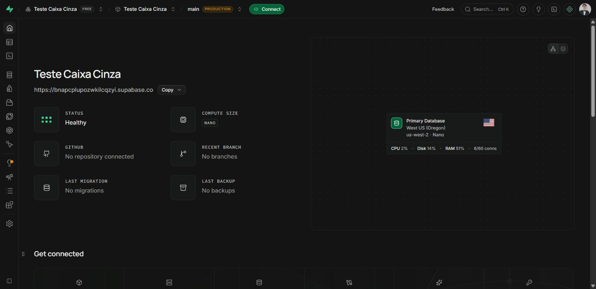

Foi utilizada autenticação por **e-mail e senha**, com o provedor Email habilitado e a opção de confirmação de e-mail ativa. A finalidade é oferecer um serviço real para comparar entradas e respostas de autenticação.

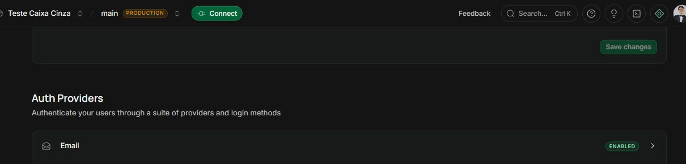

O usuário de teste foi disponibilizado com suas credenciais e verificado em Authentication → Users. O painel registra sua criação em **04/11/2026 às 17:46:22, UTC−03** e o provedor Email. O login válido também retornou os campos `email_confirmed_at` e `confirmed_at`. A tela de cadastro original não foi capturada. Para reproduzir, criar um usuário de testes por e-mail e senha e concluir a confirmação de e-mail antes do login.

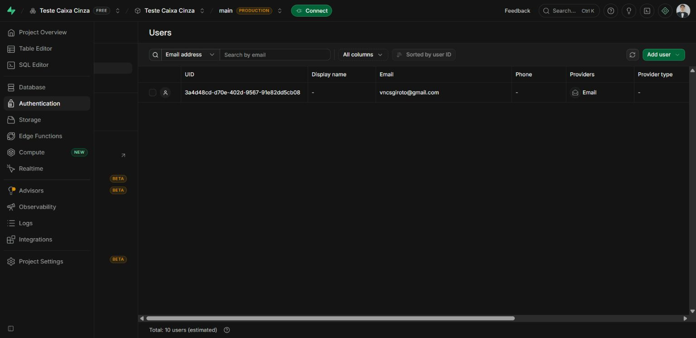

| Informação | Valor |
| --- | --- |
| API URL | `https://bnapcplupozwkilcqzyi.supabase.co` |
| Tipo da API key | Publishable (`sb_publishable_...`) |
| Usuário de teste | Identificado na captura e configurado apenas no Environment local |
| Identificação do aluno | Vinicius Giroto Francischinelli, RA 250854; coleção e Environment identificados no Postman |

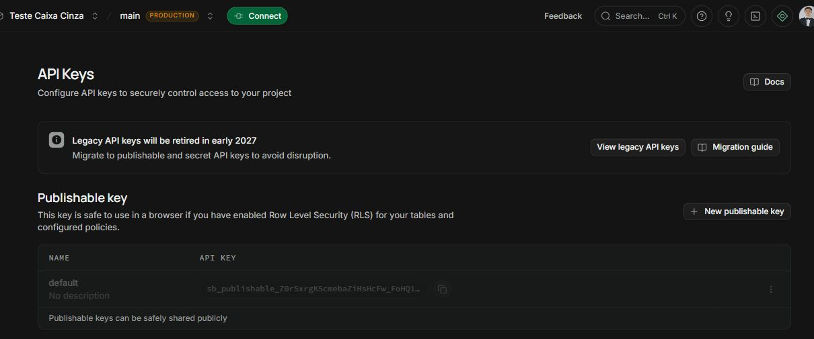

A senha do banco PostgreSQL não é uma credencial de login do Supabase Auth. Senhas de usuário, senha do banco, chaves privilegiadas e tokens completos não fazem parte desta entrega.

# Configuração do Postman

Foi utilizado o Workspace pessoal **My Workspace**, já existente, onde foi importada a coleção **Testes caixa cinza — Vinicius — RA 250854**. Para reproduzir a organização, abrir ou criar um Workspace e importar os dois arquivos da pasta `postman/`.

O Environment **Supabase — RA 250854 — local** foi importado, preenchido com as credenciais fornecidas e selecionado antes do envio. As senhas foram configuradas como variáveis sensíveis. O modelo público exportado está sem credenciais.

| Variável | Finalidade |
| --- | --- |
| `base_url` | URL HTTPS do projeto, sem barra final |
| `api_key` | Chave pública publishable do projeto |
| `email` | E-mail do usuário válido |
| `password` | Senha do usuário válido |
| `wrong_password` | Senha deliberadamente diferente da senha válida |
| `nonexistent_email` | `nao-existe-ra250854@example.invalid`, diferente do usuário cadastrado |

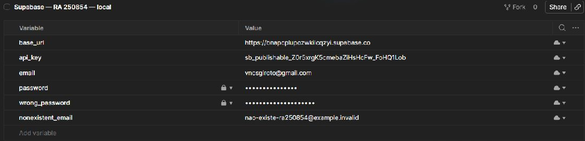

A coleção contém cinco requisições e scripts de validação. O script anterior ao envio verifica as variáveis necessárias e evita que a senha incorreta ou o usuário inexistente coincidam com as credenciais válidas. Antes da execução houve um erro local por Environment não selecionado; ele foi corrigido selecionando o Environment preenchido.

Arquivos para reprodução: [coleção](postman/autenticacao.postman_collection.json) e [modelo de Environment](postman/supabase.postman_environment.json). Importar no Postman Desktop, preencher as credenciais localmente e selecionar o Environment.

# Configuração das Requisições

**Método:** `POST`  
**Endpoint:** `{{base_url}}/auth/v1/token?grant_type=password`

O endpoint solicita uma sessão a partir do e-mail e da senha. O parâmetro `grant_type=password` identifica esse fluxo.

| Header | Valor |
| --- | --- |
| `apikey` | `{{api_key}}` — representado como XXXXX em exemplos públicos |
| `Content-Type` | `application/json` |
| `Authorization` | `Bearer {{api_key}}`, apenas no modo de chave anon JWT legada |

O template contém os três headers previstos no enunciado. Como esta execução usou uma chave **publishable**, o script removeu Authorization antes do envio. Publishable key identifica o projeto em `apikey` e não deve ser tratada como JWT Bearer. A coleção também admite uma chave pública anon JWT legada e, nesse caso, mantém Authorization.

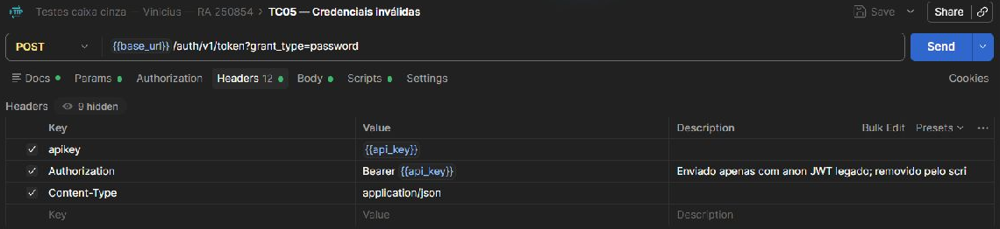

Exemplo ilustrativo de body, sem credenciais reais:

```json
{
  "email": "usuario@email.com",
  "password": "senha-do-usuario-de-teste"
}
```

No cenário válido, a coleção usa `{{email}}` e `{{password}}`. Os cenários negativos alteram os valores do corpo e preservam a API key válida, para que o teste avalie as credenciais do usuário.

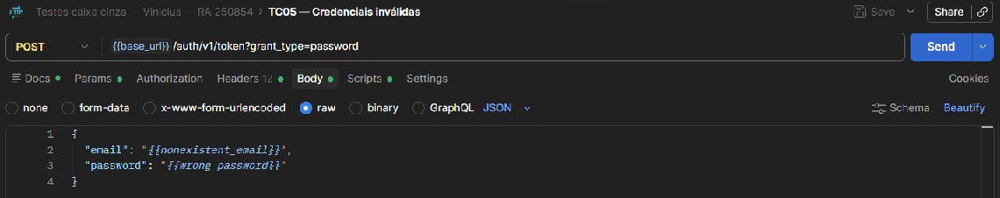

# Execução dos Testes

As requisições foram enviadas no **Postman Desktop** contra o projeto real. Foram verificados status HTTP, estrutura JSON, mensagens, presença ou ausência do access token e, no login válido, correspondência do e-mail retornado. Cada cenário teve suas asserções executadas pelo Postman.

| ID | Cenário | Entrada utilizada | Resultado esperado | Resultado obtido | Status |
| --- | --- | --- | --- | --- | --- |
| TC01 | Login válido | E-mail cadastrado e senha correta | 200, token e usuário correto | 200; token, bearer e e-mail corretos; 3/3 asserções | Sucesso |
| TC02 | Senha incorreta | E-mail cadastrado e `wrong_password` | 400, invalid_credentials e sem token | 400; invalid_credentials; 5/5 asserções | Sucesso |
| TC03 | Usuário inexistente | `nonexistent_email` e senha válida | 400, invalid_credentials e sem token | 400; invalid_credentials; 5/5 asserções | Sucesso |
| TC04 | Campos vazios | email e password como strings vazias | 400 ou 422, validação e sem token | 400; validation_failed; missing email or phone; 4/4 asserções | Sucesso |
| TC05 | Credenciais inválidas | `nonexistent_email` e `wrong_password` | 400, invalid_credentials e sem token | 400; invalid_credentials; 5/5 asserções | Sucesso |

**TC01 — Login válido.** A API retornou sessão e usuário. Os valores de access token e refresh token foram ocultados na captura; status, nomes dos campos e resultados dos testes foram preservados.

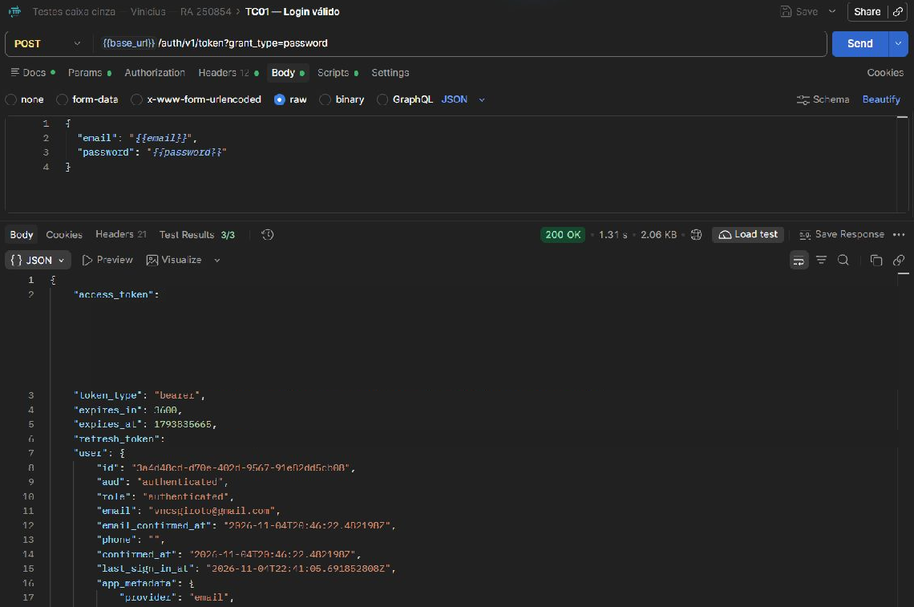

**TC02 — Senha incorreta.** A API negou o login com `Invalid login credentials` e não emitiu token.

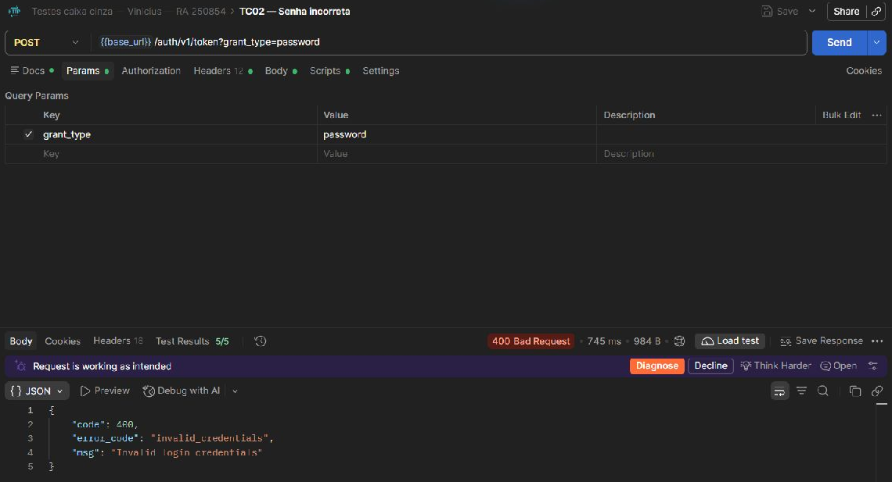

**TC03 — Usuário inexistente.** A combinação com o endereço de teste inexistente também foi rejeitada, com a mesma mensagem genérica.

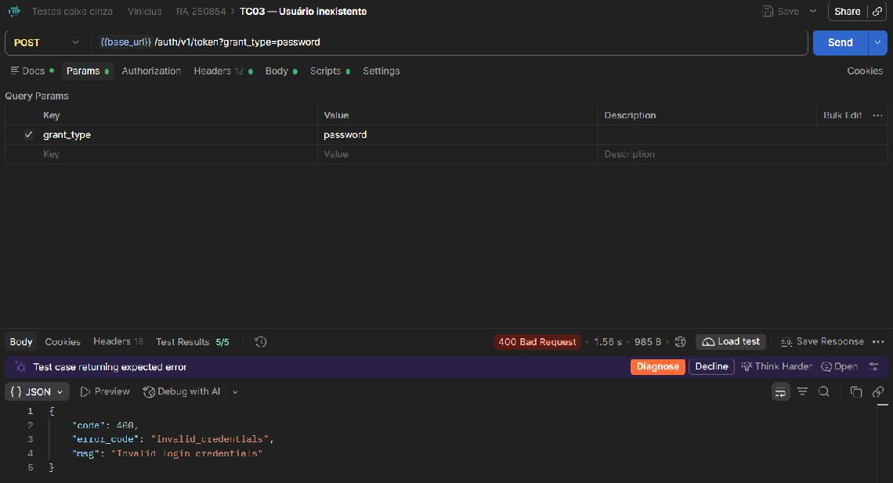

**TC04 — Campos vazios.** A API retornou `validation_failed` e `missing email or phone`. Como o e-mail já falhou na validação, a resposta não detalhou separadamente a ausência da senha.

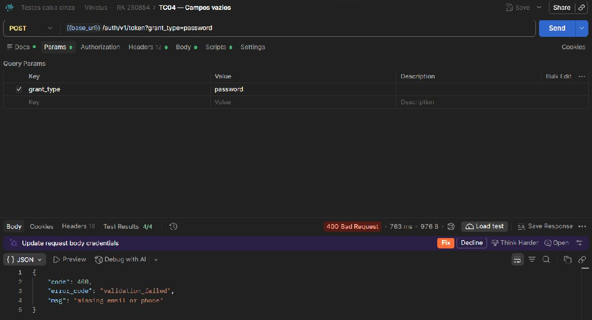

**TC05 — Credenciais inválidas.** E-mail inexistente combinado com senha incorreta foi rejeitado com `invalid_credentials`.

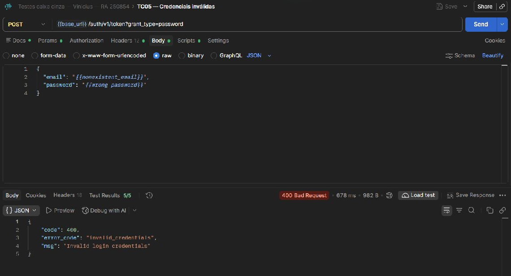

Para repetir: selecionar o Environment, abrir cada requisição, clicar em Send e conferir a aba Test Results. Uma resposta 400 é **sucesso do teste negativo** quando corresponde à rejeição esperada. Erros de API key, rede ou limite de tentativas não devem ser contabilizados como rejeição correta das credenciais.

# Registro dos Testes

Os resultados foram registrados na [planilha de testes](planilha/registro-testes.xlsx), com ID, cenário, entrada, resultado esperado, resultado obtido, status, observações e evidência correspondente. Nas observações estão a data da execução e o número de asserções aprovadas.

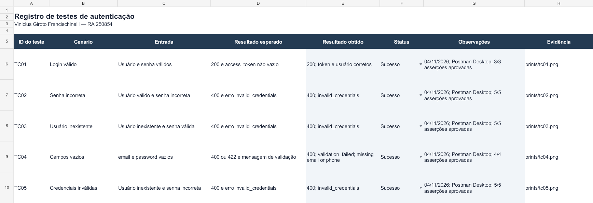

Esse registro liga cada conclusão ao cenário e ao print correspondente. As entradas descrevem as condições sem divulgar senhas. Não foram identificadas divergências funcionais nos cinco cenários. O erro de seleção do Environment foi um problema de preparação local, corrigido antes das execuções válidas.

# Resultados Obtidos

| Indicador | Resultado |
| --- | --- |
| Cenários executados | 5 |
| Cenários aprovados | 5 |
| Asserções aprovadas | 22 de 22 |
| Login válido | HTTP 200 com sessão e usuário correto |
| Entradas inválidas | HTTP 400, mensagem e ausência de token |
| Divergências funcionais | Nenhuma observada no escopo testado |

Senha incorreta e usuário inexistente receberam a mesma mensagem. Esse comportamento evita revelar, pelo texto do erro, se o e-mail tem conta. O conhecimento parcial do projeto e das variáveis permitiu distinguir os cenários mesmo com respostas equivalentes.

As imagens foram capturadas do ambiente real. Os prints do Postman foram refeitos com janela maximizada e recortados sem redimensionamento para remover cursor, outras atividades e áreas externas à evidência. Somente valores de tokens foram mascarados. A imagem da planilha é uma renderização do arquivo preenchido, não uma captura do aplicativo Excel.

# Conclusão

Os cinco cenários foram executados no Postman Desktop e atenderam aos critérios definidos. A autenticação emitiu uma sessão para o usuário válido, rejeitou as combinações de credenciais incorretas e validou campos vazios. Não foi observada falha funcional nesses casos.

As dificuldades foram distinguir a senha do banco da senha do usuário, selecionar o Environment correto, adequar o header Authorization ao tipo de API key e produzir capturas legíveis sem expor tokens. Essas questões foram resolvidas na preparação e na documentação.

Como melhorias de cobertura, recomenda-se testar separadamente e-mail vazio e senha vazia, e-mail não confirmado, expiração de sessão, refresh token, logout, MFA e limites de tentativas. Os resultados atuais não demonstram a segurança completa da API, pois representam somente cinco cenários funcionais.

Os testes de caixa cinza permitem relacionar configurações conhecidas com o comportamento externo da API, verificar o contrato e documentar resultados reproduzíveis.

Referências técnicas: [Supabase Auth por senha](https://supabase.com/docs/guides/auth/passwords) e [API keys](https://supabase.com/docs/guides/getting-started/api-keys).
