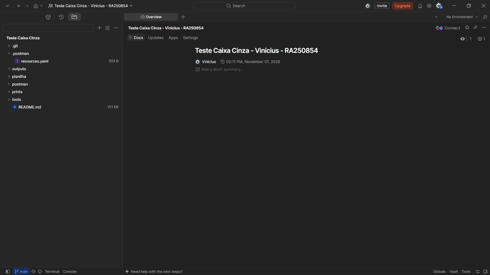
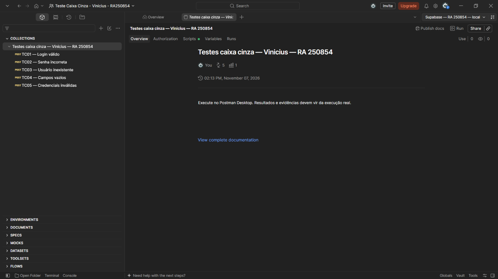

# Introdução

**Aluno:** Vinicius Giroto Francischinelli  
**RA:** 250854

Nesta atividade, realizei testes de caixa cinza na API de autenticação do Supabase usando o Postman Desktop. Configurei um ambiente com autenticação por e-mail e senha e executei cinco cenários para verificar o comportamento da API com dados válidos e inválidos.

Executei os testes apresentados neste relatório em **07/11/2026**. Todos os cenários tiveram o resultado esperado, com **22 de 22 asserções aprovadas**. Os prints deste repositório foram tirados por mim durante a atividade.

# Objetivo da Atividade

Meu objetivo foi aplicar testes de caixa cinza em uma API, utilizando informações conhecidas sobre o sistema, como endpoint, headers, autenticação e corpo JSON, sem acessar seu código interno.

Verifiquei os status HTTP, as respostas JSON, as mensagens de erro e a emissão de access token. Para isso, utilizei Supabase, Postman Desktop e GitHub. A atividade não exigiu a criação de uma interface gráfica.

# Configuração do Supabase

Criei o projeto pelo formulário **New project**, na organização **Teste Caixa Cinza**. Informei o nome **Teste Caixa Cinza**, defini uma senha para o banco de dados e selecionei **Americas** como região. Depois do provisionamento, o projeto ficou na região **West US (Oregon)**.

O print abaixo mostra o formulário que utilizei. Os campos estão vazios porque voltei à tela para documentar o processo; não criei outro projeto.


Em **Authentication → Sign In / Providers**, utilizei o provedor **Email**, que está habilitado. A opção **Confirm email** também está ativa.


Criei o usuário de teste pelo painel **Authentication → Users → Add user**, informando e-mail e senha. Esse usuário foi utilizado no cenário de login válido. O cadastro pode ser conferido no painel abaixo.


| Configuração | Valor utilizado |
| --- | --- |
| Projeto | Teste Caixa Cinza |
| Identificador | `bnapcplupozwkilcqzyi` |
| API URL | `https://bnapcplupozwkilcqzyi.supabase.co` |
| Autenticação | E-mail e senha |
| API key usada na execução final | Chave pública `anon` legada, em formato JWT |

Obtive a chave pública em **Settings → API Keys → View legacy API keys**. Na execução final, usei a chave `anon` para enviar os três headers pedidos no enunciado. A URL e a chave configuradas podem ser conferidas no print do Environment, na próxima seção.

O objetivo dessa configuração foi disponibilizar uma API real de autenticação para os testes. A senha do banco é diferente da senha do usuário de autenticação. Não incluí senhas, chaves privilegiadas ou tokens de sessão completos nos arquivos públicos.

# Configuração do Postman

No Postman Desktop, criei o Workspace **Teste Caixa Cinza - Vinicius - RA250854**. Usei meu nome e RA para identificar o ambiente da atividade.



Importei a coleção **Testes caixa cinza — Vinicius — RA 250854**, que reúne as cinco requisições, e o Environment **Supabase — RA 250854 — local**.



Configurei as seguintes variáveis:

| Variável | Finalidade |
| --- | --- |
| `base_url` | Armazenar a URL da API do Supabase |
| `api_key` | Armazenar a chave pública `anon` do projeto |
| `email` | Armazenar o e-mail do usuário válido |
| `password` | Armazenar a senha do usuário válido |
| `wrong_password` | Usar uma senha diferente da senha correta nos testes negativos |
| `nonexistent_email` | Usar um endereço inexistente no projeto |


Antes de enviar as requisições, selecionei o Environment no canto superior direito. Usei variáveis para reaproveitar os dados entre os testes e mantive as senhas ocultas. O Postman foi utilizado para enviar os pedidos, visualizar as respostas e executar as asserções da coleção.

Os arquivos para importar estão em [coleção de testes](postman/autenticacao.postman_collection.json) e [modelo de Environment](postman/supabase.postman_environment.json). O modelo público está sem credenciais e precisa ser preenchido localmente.

# Configuração das Requisições

Criei requisições com o método **POST** para o endpoint:

```text
{{base_url}}/auth/v1/token?grant_type=password
```

Esse endpoint solicita uma sessão de autenticação a partir do e-mail e da senha. Configurei os seguintes headers:

| Header | Valor |
| --- | --- |
| `apikey` | `{{api_key}}` — XXXXX em exemplos sem credenciais |
| `Authorization` | `Bearer {{api_key}}` |
| `Content-Type` | `application/json` |

Na execução final, a variável `api_key` contém a chave pública `anon` legada. O script de preparação da coleção mantém o header Authorization quando essa chave é utilizada. A coleção também permite uma chave publishable, mas nesse caso remove Authorization antes do envio.


Configurei o corpo no formato **raw → JSON**. No cenário válido, utilizei:

```json
{
  "email": "{{email}}",
  "password": "{{password}}"
}
```

Um exemplo ilustrativo, sem dados reais, seria:

```json
{
  "email": "usuario@email.com",
  "password": "senha-do-usuario-de-teste"
}
```

Nos testes negativos, alterei os valores do corpo conforme cada cenário, mantendo a API key válida. No TC05, por exemplo, usei `{{nonexistent_email}}` e `{{wrong_password}}`.


# Execução dos Testes

Executei os cinco cenários no Postman Desktop. Para cada um, enviei a requisição pelo botão **Send** e conferi o status HTTP, o JSON e o resultado em **Test Results**.

| ID | Cenário | Entrada utilizada | Resultado esperado | Resultado obtido | Status |
| --- | --- | --- | --- | --- | --- |
| TC01 | Login válido | E-mail cadastrado e senha correta | HTTP 200, access token e usuário correto | HTTP 200, token e usuário correto; 3/3 asserções | Sucesso |
| TC02 | Senha incorreta | E-mail válido e `wrong_password` | Erro de autenticação e ausência de token | HTTP 400, `invalid_credentials`; 5/5 asserções | Sucesso |
| TC03 | Usuário inexistente | `nonexistent_email` e senha válida | Acesso negado e ausência de token | HTTP 400, `invalid_credentials`; 5/5 asserções | Sucesso |
| TC04 | Campos vazios | `email` e `password` vazios | Erro de validação e ausência de token | HTTP 400, `validation_failed`, `missing email or phone`; 4/4 asserções | Sucesso |
| TC05 | Credenciais inválidas | `nonexistent_email` e `wrong_password` | Mensagem de erro e ausência de token | HTTP 400, `invalid_credentials`; 5/5 asserções | Sucesso |

**TC01 — Login válido:** recebi HTTP 200 e um access token. As três asserções foram aprovadas. Os valores dos tokens foram ocultados apenas na imagem publicada.


**TC02 — Senha incorreta:** recebi HTTP 400 e a mensagem `Invalid login credentials`, sem emissão de token.


**TC03 — Usuário inexistente:** o login também foi negado com HTTP 400 e `invalid_credentials`.


**TC04 — Campos vazios:** a API retornou HTTP 400, código `validation_failed` e mensagem `missing email or phone`.


**TC05 — Credenciais inválidas:** ao combinar e-mail inexistente e senha incorreta, recebi HTTP 400 e `Invalid login credentials`.


Nos cenários negativos, o HTTP 400 representa o comportamento esperado, por isso registrei os testes como sucesso. Não encontrei divergências entre os resultados esperados e os obtidos nesses cinco cenários.

# Registro dos Testes

Registrei os testes na [planilha de testes](planilha/registro-testes.xlsx), preenchendo ID, cenário, entrada, resultado esperado, resultado obtido, status, observações e caminho da evidência. Nas observações, informei a data **07/11/2026** e a quantidade de asserções aprovadas.


Por exemplo, no TC01 registrei HTTP 200 e a confirmação de token e usuário correto. No TC04, registrei HTTP 400 e a mensagem de validação recebida. Esse registro permite relacionar cada resultado ao seu cenário e à evidência correspondente.

Considero essa documentação importante porque facilita a revisão dos testes e a comparação com execuções futuras. Não identifiquei falhas funcionais nos casos avaliados.

# Resultados Obtidos

| Indicador | Resultado |
| --- | --- |
| Data da execução final | 07/11/2026 |
| Cenários executados | 5 |
| Cenários aprovados | 5 |
| Asserções aprovadas | 22 de 22 |
| Login válido | HTTP 200, token e usuário correto |
| Cenários negativos | HTTP 400 com mensagem de erro e sem token |
| Falhas funcionais identificadas | Nenhuma nos cenários testados |

Observei que senha incorreta e usuário inexistente retornam a mesma mensagem genérica. Isso evita informar diretamente se determinado e-mail está cadastrado. Mesmo com respostas semelhantes, os cenários são diferentes pelas entradas utilizadas.

Todos os prints apresentados foram capturados por mim. Mantive os arquivos na resolução original e ocultei apenas os valores dos tokens nas imagens de login. A imagem da planilha mostra o arquivo preenchido aberto no aplicativo.

# Conclusão

Consegui executar os cinco cenários no Postman Desktop e verificar o funcionamento da autenticação. O usuário válido recebeu uma sessão, enquanto as entradas incorretas foram rejeitadas. Todos os testes tiveram os resultados esperados.

Durante a configuração, precisei entender a diferença entre a senha do banco e a senha do usuário, selecionar o Environment correto e distinguir a chave publishable da chave pública anon. Na execução final, utilizei a anon para manter os três headers previstos na atividade.

Não encontrei falhas funcionais nos cenários avaliados. Como melhoria, eu acrescentaria testes de senha vazia e e-mail vazio separadamente, e-mail não confirmado, expiração de sessão, refresh token, logout e limite de tentativas. Os cinco testes realizados não cobrem todas as situações possíveis da API.

A atividade me ajudou a compreender como os testes de caixa cinza utilizam informações parciais do sistema para verificar seu comportamento externo. Conhecer o endpoint, os headers e os dados de entrada foi necessário para interpretar as respostas e registrar os resultados.

Referências utilizadas: [Supabase Auth por senha](https://supabase.com/docs/guides/auth/passwords) e [chaves de API do Supabase](https://supabase.com/docs/guides/getting-started/api-keys).
